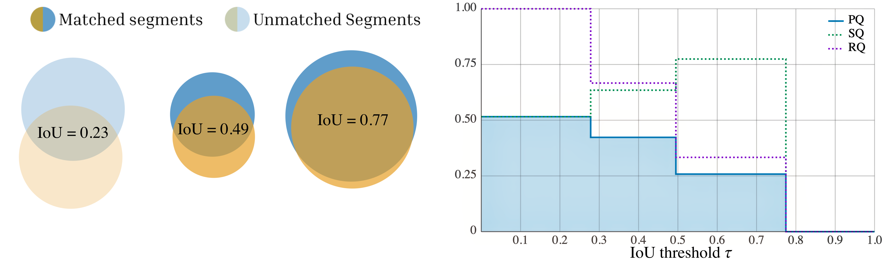
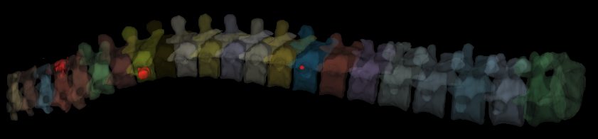
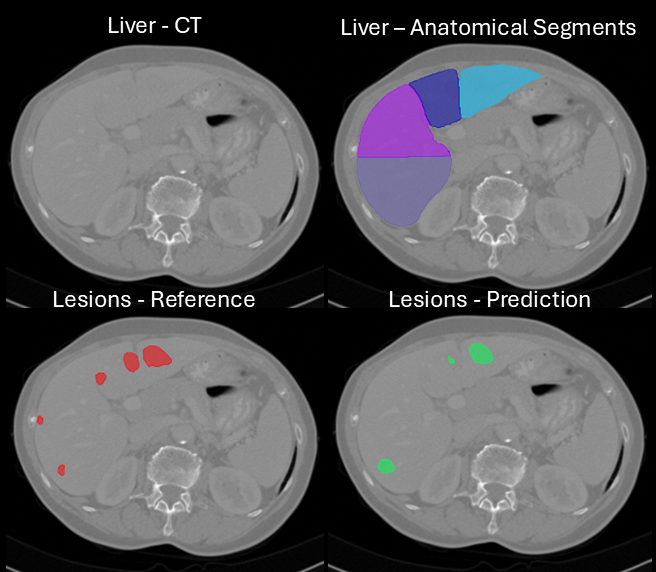

## Interactive playground to explore PQ across different thresholds and matching strategies
[https://pq-interactive.vercel.app](https://pq-interactive.vercel.app)

## Notebook demonstrating vertebral segmentation 
[Notebook vertebral](./example_vertebral.ipynb)

## Notebook demonstrating part aware liver segmentation 
[Notebook part aware liver](./example_liver.ipynb)

## Notebook demonstrating BraTS metastasis segmentation
[Notebook metastasis](./example_brats_mets.ipynb)
